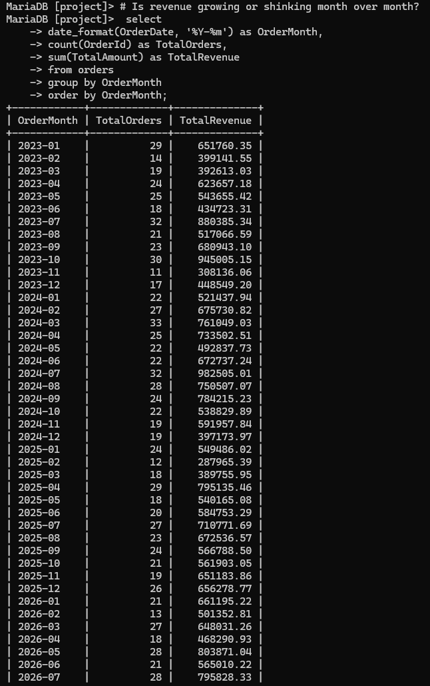
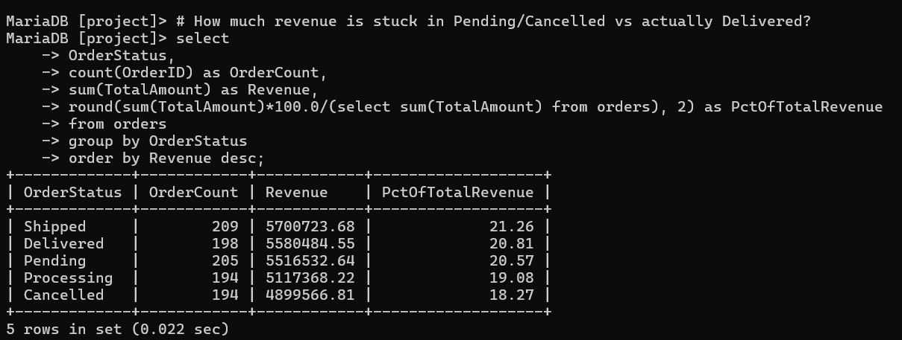
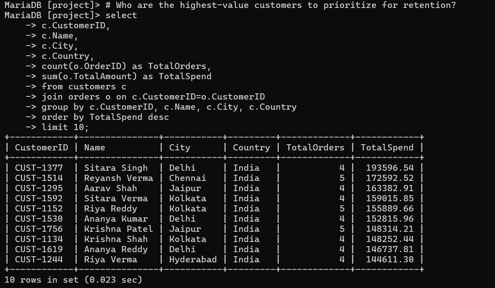

# 🛒 E-commerce Sales & Customer Analysis (SQL)

## 📌 About the Project

The E-commerce Sales & Customer Analysis project is a SQL-based data analytics project designed to analyze sales performance, customer purchasing behavior, and order fulfillment.

The project uses three datasets: Customers, Orders, and Products. SQL queries are used to extract meaningful business insights, identify high-value customers, track monthly revenue trends, and understand order statuses.

The main objective is to transform raw e-commerce data into useful business insights that can help improve sales performance, customer retention, and business decision-making.

## 🛠️ Technologies & Tools Used

- MariaDB / MySQL
- SQL
- XAMPP
- phpMyAdmin
- CSV Datasets

## 📂 Datasets Used

| Dataset | Description | Records |
|---|---|---:|
| customers.csv | Customer information, location, and signup date | 800 |
| orders.csv | Order details, dates, status, and total amount | 1,000 |
| products.csv | Product names, categories, brands, and prices | 34 |

**Note:** The Products dataset contains only 34 linked orders out of 1,000 orders. Therefore, product-level analysis is based on a limited sample.

## ✨ Features

- Monthly revenue and order trend analysis.
- Identification of top 10 highest-spending customers.
- Revenue analysis by order status.
- Country-wise and city-wise sales analysis.
- Average order value calculation.
- Monthly customer signup analysis.
- Repeat vs one-time customer analysis.
- RFM-lite customer ranking.
- Product category and brand analysis.
- Identification of high-value product orders.

## 💻 SQL Concepts Used

- SELECT and WHERE statements.
- GROUP BY and ORDER BY.
- Aggregate Functions (SUM, COUNT, AVG).
- INNER JOIN and multiple JOINs.
- Subqueries.
- Common Table Expressions (CTEs).
- CASE Statements.
- Date Functions (DATE_FORMAT).
- Window Functions (RANK).
- LIMIT.

## 📊 Business Questions Solved

1. Is revenue growing or declining month over month?
2. How much revenue is stuck in Pending/Cancelled vs actually Delivered?
3. Who are the highest-value customers to prioritize for retention?
4. Which countries and cities generate the highest revenue?
5. What is the average order value overall and monthly?
6. How many new customers sign up each month?
7. What percentage of customers are repeat vs one-time buyers?
8. Which customers have the highest RFM-lite ranking?
9. Which product categories and brands perform best?
10. What are the highest-value product orders?

## 📸 Project Screenshots

### 1. Monthly Revenue & Order Trend



### 2. Revenue by Order Status



### 3. Top 10 Highest-Value Customers



## 💡 Key Insights

- Monthly revenue fluctuates across different months.
- July 2024 recorded the highest monthly revenue in the displayed results, approximately 982,505.
- Pending orders account for 20.57% of total revenue.
- Cancelled orders account for 18.27% of total revenue.
- Pending and Cancelled orders together represent 38.84% of total revenue.
- Sitara Singh (CUST-1377) is the highest-spending customer in the displayed results, with total spending of 193,596.54.

**Business Insight:** Monitoring pending and cancelled orders can help businesses identify potential revenue risks and improve order fulfillment. Identifying high-value customers can also support targeted retention strategies.

## ⚙️ How to Run the Project

1. Install XAMPP on your computer.
2. Start Apache and MySQL.
3. Open phpMyAdmin in your browser.
4. Create a database named `ecommerce_analysis`.
5. Execute `create_tables.sql` to create the required tables.
6. Import the three CSV datasets into their respective tables.
7. Open `analysis_queries.sql`.
8. Execute the SQL queries one by one.
9. Review the query results and business insights.

## 📁 Project Structure

```text
Ecommerce-Sales-Customer-Analysis/
│
├── datasets/
│   ├── customers.csv
│   ├── orders.csv
│   └── products.csv
│
├── screenshots/
│   ├── monthly_revenue.png
│   ├── order_status_revenue.png
│   └── top_customers.png
│
├── create_tables.sql
├── analysis_queries.sql
└── README.md
```

## 🎯 Learning Outcomes

- Understanding relational databases and SQL.
- Performing data analysis using SQL queries.
- Working with multiple tables using JOINs.
- Analyzing business performance through aggregations.
- Using CTEs and window functions.
- Extracting meaningful insights from raw datasets.
- Developing analytical and problem-solving skills.

## 👩‍💻 Author

**Sakshi Shimpi**

- GitHub: [sakshishimpi03](https://github.com/sakshishimpi03)
- LinkedIn: [sakshi-shimpi](https://linkedin.com/in/sakshi-shimpi)

---

